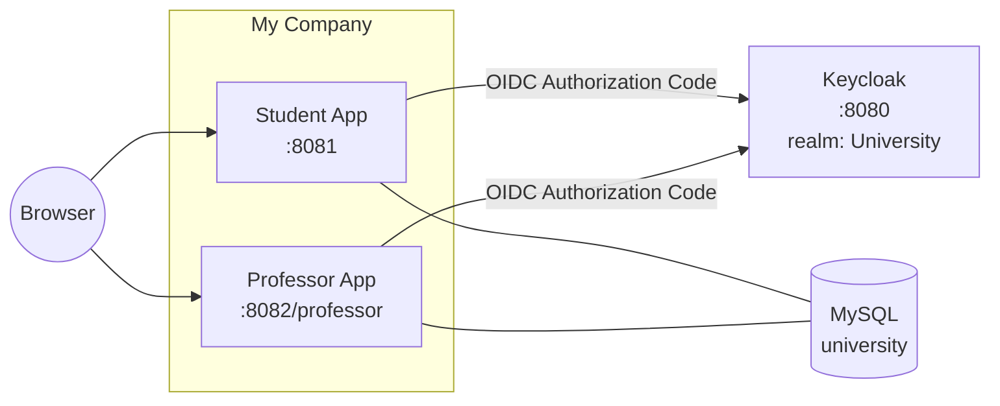

# Spring Boot Keycloak SSO

[](https://github.com/hendisantika/spring-boot-keycloak-sso/actions/workflows/maven.yml)


Single Sign-On (SSO) demo with two Spring Boot web applications — **Student App** and **Professor App** — that
share one login session through **Keycloak** using standard **OpenID Connect** (Spring Security OAuth2 Client).
Log in once in either app and you are automatically signed in to the other; log out and the Keycloak SSO session
is terminated as well.

## Architecture



1. The user opens a protected page (e.g. `/home`) in one of the apps.
2. The app redirects to Keycloak (`/oauth2/authorization/keycloak`), the user logs in.
3. Keycloak redirects back with an authorization code; the app exchanges it for tokens.
4. Keycloak **realm roles** / **client roles** from the ID token (`PROFESSOR`, `STUDENT`) are mapped to Spring
   Security authorities and checked with `@PreAuthorize`.
5. When the user opens the other app, Keycloak already has an SSO session → no second login.

## Tech Stack

| Component        | Version / Notes                                                      |
|------------------|----------------------------------------------------------------------|
| Java             | **25** (Temurin)                                                     |
| Spring Boot      | 4.1.x (Web MVC, Security, OAuth2 Client, Data JPA, Thymeleaf)        |
| Identity Provider| Keycloak (OpenID Connect)                                            |
| Database         | MySQL 8 (runtime), H2 (tests only)                                   |
| Build            | Maven (wrapper included in each app)                                 |
| CI               | GitHub Actions (matrix build of both apps on JDK 25)                 |
| Dependency bot   | Dependabot (Maven + GitHub Actions, grouped updates)                 |

> **Note:** the legacy `keycloak-spring-boot-starter` adapter is deprecated/EOL and does not work with
> Spring Boot 4 / Spring Security 7. This project uses Spring Security's native OAuth2 Client instead.

## Project Structure

```
spring-boot-keycloak-sso
├── professor-app/          # Professor web app  (port 8082, context path /professor)
├── student-app/            # Student web app    (port 8081)
├── .github/
│   ├── dependabot.yml      # Dependabot config (Maven + GitHub Actions)
│   └── workflows/maven.yml # CI: build & test both apps on JDK 25
└── README.md
```

## Endpoints

| App           | URL                                              | Access                     |
|---------------|--------------------------------------------------|----------------------------|
| Student App   | http://localhost:8081/contact-us                 | Public                     |
| Student App   | http://localhost:8081/home                       | Any authenticated user     |
| Student App   | http://localhost:8081/manage-students            | Role `PROFESSOR`           |
| Professor App | http://localhost:8082/professor/contact-us       | Public                     |
| Professor App | http://localhost:8082/professor/home             | Role `PROFESSOR`           |
| Professor App | http://localhost:8082/professor/manage-students  | Role `PROFESSOR`           |

Unauthorized access is redirected to `/access-denied`.

## Prerequisites

- JDK 25
- Maven 3.9+ (or use the bundled `./mvnw`)
- Docker (to run Keycloak and MySQL locally)

## Getting Started

### 1. Run MySQL

```bash
docker run -d --name mysql -p 3306:3306 \
  -e MYSQL_ROOT_PASSWORD=root -e MYSQL_DATABASE=university \
  mysql:8.4
```

### 2. Run Keycloak

```bash
docker run -d --name keycloak -p 8080:8080 \
  -e KC_BOOTSTRAP_ADMIN_USERNAME=admin -e KC_BOOTSTRAP_ADMIN_PASSWORD=admin \
  quay.io/keycloak/keycloak:latest start-dev
```

Open the admin console at http://localhost:8080 (`admin` / `admin`).

### 3. Configure Keycloak

1. **Create realm** `University`.
2. **Create realm roles** `PROFESSOR` and `STUDENT`.
3. **Create clients** (OpenID Connect, *Client authentication* = **On**, *Standard flow* = **On**):

   | Client ID       | Valid redirect URIs                                          | Valid post logout redirect URIs              | Web origins             |
   |-----------------|--------------------------------------------------------------|----------------------------------------------|-------------------------|
   | `student-app`   | `http://localhost:8081/login/oauth2/code/keycloak`           | `http://localhost:8081/contact-us`           | `http://localhost:8081` |
   | `professor-app` | `http://localhost:8082/professor/login/oauth2/code/keycloak` | `http://localhost:8082/professor/contact-us` | `http://localhost:8082` |

   Copy each client's secret from the *Credentials* tab.
4. **Expose roles in the ID token:** *Client scopes* → `roles` → *Mappers* → `realm roles` → enable
   **Add to ID token** (do the same for `client roles` if you use client roles).
5. **Create users** (e.g. `john` with role `STUDENT`, `sachin` with role `PROFESSOR`) and set their passwords
   (*Credentials* tab, *Temporary* = Off).

### 4. Configure & run the apps

Both apps read their settings from environment variables (with local defaults):

| Variable                 | Default                 | Description                         |
|--------------------------|-------------------------|-------------------------------------|
| `KEYCLOAK_URL`           | `http://localhost:8080` | Keycloak base URL                   |
| `KEYCLOAK_REALM`         | `University`            | Keycloak realm                      |
| `KEYCLOAK_CLIENT_SECRET` | *(demo secret)*         | Client secret of `student-app` / `professor-app` |
| `DB_HOST` / `DB_PORT`    | `localhost` / `3306`    | MySQL host / port                   |
| `DB_USERNAME` / `DB_PASSWORD` | `root` / `root`    | MySQL credentials                   |

```bash
# terminal 1
cd student-app
KEYCLOAK_CLIENT_SECRET=<student-app-secret> ./mvnw spring-boot:run

# terminal 2
cd professor-app
KEYCLOAK_CLIENT_SECRET=<professor-app-secret> ./mvnw spring-boot:run
```

### 5. Try SSO

1. Open http://localhost:8081/home → you are redirected to the Keycloak login page → log in.
2. Open http://localhost:8082/professor/home → you are signed in **without logging in again**.
3. Click **Logout** in either app → the Keycloak session ends, and both apps require a new login.

## Build & Test

```bash
(cd student-app && ./mvnw -B verify)
(cd professor-app && ./mvnw -B verify)
```

Tests run with the `test` profile (in-memory H2) and don't need MySQL or Keycloak.

## CI & Dependency Updates

- **GitHub Actions** (`.github/workflows/maven.yml`): builds and tests `professor-app` and `student-app` in
  parallel on **JDK 25** for every push / pull request to `main`, and submits the Maven dependency graph to
  GitHub on pushes to `main`.
- **Dependabot** (`.github/dependabot.yml`): daily checks (05:00 Asia/Jakarta) for Maven dependencies of both apps
  and for GitHub Actions. Spring Boot updates are grouped together, other minor/patch updates are bundled into a
  single PR, and commit messages follow Conventional Commits (`build(deps): …`, `ci(deps): …`).

## Author

**Hendi Santika** — [s.id/hendisantika](https://s.id/hendisantika) · Telegram [@hendisantika34](https://t.me/hendisantika34)

## License

This project is licensed under the terms of the [LICENSE](LICENSE) file.
